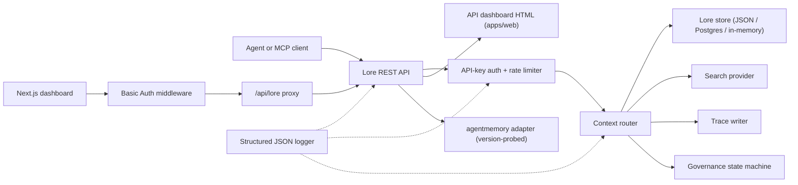

# Architecture

Lore Context is a cloud memory control plane around capture, memory lifecycle,
hybrid recall, repository graphs, traces, evaluation, migration, and governance.
The open-core release is deployable as a local single process or small Docker
Compose stack. The current hosted line is `v2.1.0` (deployed to AWS production
and the public website): the graph-augmented hybrid memory engine with every
advertised retrieval stream — Postgres FTS, pgvector, Qdrant dense, Qdrant
sparse, graph, temporal, and wiki — mounted in a single
`HybridSearchOrchestrator`, plus a post-fusion local cross-encoder reranker, the
dreaming butler memory-consolidation worker, the agent memory self-improvement
loop, and the v2.1 repo graph surface. RDS PostgreSQL remains the truth store,
AWS SQS handles worker fan-out, the private Qwen3-Embedding-0.6B service produces
1024-dim dense vectors, and the `memory_wiki_pages.wiki_embedding` column lets
the wiki provider contribute pgvector candidates alongside FTS. The open-core
substrate is published to `Lore-Context/lore-context` under Apache 2.0; the
hosted multi-tenant operations layer ships only on `Lore-Context/lore-cloud`
(see [oss-vs-commercial-boundary.md](oss-vs-commercial-boundary.md)).

v2.1.0 adds `@lore/repo-graph` — deterministic TypeScript/JavaScript repository
indexing for files, symbols, imports, calls, routes, tests, and process hints —
exposed through API routes (`/v1/repo/graph/query`, `/v1/repo/symbol/context`,
`/v1/repo/impact`, `/v1/repo/detect-changes`) and read-only MCP tools
(`repo.graph_query`, `repo.symbol_context`, `repo.impact`,
`repo.detect_changes`). The repo graph Postgres schema
(`apps/api/src/db/schema-v21-repo-graph.sql`) is additive.

## Component Map

| Component | Path | Role |
|---|---|---|
| API | `apps/api` | REST control plane, auth/session/token issuance, capture ingestion, recall, hosted MCP, rate limit, structured logger, graceful shutdown |
| Dashboard | `apps/dashboard` | Next.js 16 ordinary-user SaaS dashboard with Google session cookies, CSRF-protected token issuance, Memory Inbox, source controls, recall tester, and developer surfaces |
| Memory worker | `apps/api/src/worker.ts` | v1.1 SQS worker for capture curation, auto-save, embedding, Qdrant indexing, graph, connector, and backfill lanes |
| MCP Server | `apps/mcp-server` | stdio MCP surface (legacy + official SDK transports) with zod-validated tool inputs; hosted MCP is exposed through the API for beta users |
| Web HTML | `apps/web` | Server-rendered HTML fallback UI shipped alongside the API |
| Shared types | `packages/shared` | `MemoryRecord`, `ContextQueryResponse`, `EvalMetrics`, `AuditLog`, errors, ID utils |
| AgentMemory adapter | `packages/agentmemory-adapter` | Bridge to upstream `agentmemory` runtime with version probe and degraded mode |
| Search | `packages/search` | Seven-stream `HybridSearchOrchestrator` + recipe adapter |
| Repo graph | `packages/repo-graph` | Deterministic TypeScript/JavaScript repository indexing (files, symbols, imports, calls, routes, tests, process hints) — v2.1 |
| Code indexer | `packages/code-indexer`, `packages/code-indexer-python` | Code knowledge graph indexers for TypeScript/JavaScript and Python |
| Model gateway | `packages/model-gateway` | Multi-provider task→model routing |
| MIF | `packages/mif` | Memory Interchange Format v0.2 — JSON + Markdown export/import |
| Eval | `packages/eval` | `EvalRunner` + metric primitives (Recall@K, Precision@K, MRR, staleHit, p95) + `ContextRecipeSpec` / `ContextRecipeTrial` / `PromotionDecision` recipe types |
| Governance | `packages/governance` | Six-state state machine, risk-tag scanning, poisoning heuristics, audit log |

## v1.1 Baseline And v1.2 Upgrade Direction

`v1.1.0-beta` is the Cloud Memory Engine line. The architecture goal is to make
memory automatic, accurate, explainable, and safe for ordinary SaaS users without
requiring them to understand MCP, hooks, tokens, embeddings, graph internals, or
model settings.

`v1.2.0-beta` keeps that cloud baseline and upgrades the recall substrate:
Postgres FTS + pgvector becomes the primary SQL fallback, Qdrant moves to the
`lore_memories_v12` collection, memories are split into episodes, items, chunks,
and embeddings, and a Postgres-backed temporal graph gives retrieval an
explainable relationship layer.

v1.1/v1.2 production additions:

| Addition | Path | Purpose |
|---|---|---|
| Autonomous curator | `apps/api/src/curator.ts`, `apps/api/src/cloud.ts` | Redact, classify, score, decide, auto-save low-risk observations, and route exceptions to Memory Inbox |
| Worker fan-out | `apps/api/src/worker.ts`, `docs/deployment/v11-sqs-runbook.md` | Move capture, embedding, graph, connector, and backfill work off the request path through AWS SQS queues and DLQs |
| Embedding service | `apps/api/src/embedding.ts`, `docs/deployment/v11-embedding-service-runbook.md` | Private Qwen3-Embedding-0.6B client producing 1024-dim dense vectors with degraded-mode behavior |
| Qdrant recall index | `apps/api/src/qdrant-index.ts`, `docs/deployment/v11-qdrant-runbook.md` | Dense Qwen vectors + sparse BM25 payload-filtered by vault/account/project/status |
| Hybrid recall hydration | `apps/api/src/index.ts` | Retrieve through Qdrant, hydrate from RDS, and drop stale/deleted/index-only hits before returning `lore-hybrid` results |
| RDS source of truth | `apps/api/src/db/schema.sql`, `docs/deployment/v11-rds-runbook.md` | Accounts, vaults, tokens, capture state, memory records, lifecycle, graph-lite state, usage, and audit |
| Public SaaS dashboard | `apps/dashboard` | Ordinary-user Google sign-in, agent connect, Memory Inbox exception queue, recently remembered items, privacy controls, and recall tester |
| Evidence and operations | `scripts/release/smoke-v11-gates.mjs`, `docs/deployment/v11-observability-runbook.md` | Production smoke gates for worker health, Qdrant coverage, restore proofs, DLQ checks, and recall quality |

The central read model is signal-centric. v2.0.9 shifts the primary learning
signal from explicit human feedback to passive agent-observable signals:

```text
ContextTrace
  ├── retrievedMemoryIds
  ├── composedMemoryIds
  ├── ignoredMemoryIds
  ├── warnings
  ├── passiveSignals (primary v2.0.9 path)
  │   ├── useCount / lastUsedAt       ← did the agent actually use this memory?
  │   ├── staleness                   ← was a memory ignored because it was stale?
  │   ├── governance                  ← did governance auto-redact or flag?
  │   └── contradiction               ← was a memory superseded or contradicted?
  └── feedback (optional legacy v1.x path)
        │
        v
EvidenceLedger
  ├── summary: retrieved / used / ignored / warnings / risk tags
  ├── rows: one row per memory disposition
  └── actions: view / forget / supersede / mark wrong / mark outdated
```

This uses persisted trace and memory records first. In v1.1, Qdrant is a derived
recall index; RDS memory records remain authoritative for hydration, lifecycle,
and tenant isolation.

In v2.0.9, normal users are **not** asked to label or score memory quality.
Passive agent signals (use counts, staleness, governance auto-decisions,
supersede/contradiction chains) are the primary learning signal. The optional
`POST /v1/traces/:trace_id/feedback` endpoint is preserved as a legacy v1.x
compatibility surface but is not the primary learning path.

## v1.2 Architecture Direction

`v1.2.0-beta` extends the v1.1 cloud memory engine with a graph-augmented
hybrid recall path. Production activation is guarded by the local v12 eval gate
and the release preflight. The canonical plan lives in
`.omx/plans/lore-v1.2-graph-augmented-hybrid-memory-engine-plan.md`.

**What changes versus v1.1:**

The v1.1 Postgres fallback still relies on a full-table memory snapshot loaded at
startup, and the pgvector table uses `vector(384)` — mismatched against the 1024-dim
Qwen3 embeddings already in production. v1.2 resolves both gaps and adds a temporal
graph layer:

1. **New memory schema** (`apps/api/src/db/schema-v12.sql`): replaces the flat
   `memory_records` / `memory_embeddings(384)` shape with an `episode → item → chunk
   → embedding` ledger at 1024 dims, plus graph tables (`memory_entities`,
   `memory_relations`, `memory_relation_evidence`) and a reserved wiki slot
   (`memory_wiki_pages`). Old v1.1 tables remain intact; the v12 path is gated by
   `LORE_MEMORY_ENGINE_VERSION=v12`.

2. **Postgres FTS + pgvector provider**: a new `PostgresHybridMemorySearchProvider`
   replaces the in-memory substring fallback with `websearch_to_tsquery` FTS + HNSW
   pgvector ANN, fused via weighted RRF. This makes the local/CI/degraded path
   production-quality without Qdrant.

3. **Qdrant v12 collection** (`lore_memories_v12`): chunk/item payload shape,
   Qdrant Query API with native RRF prefetch, and `entity_ids` / `relation_ids`
   payload fields for graph-stream correlation.

4. **Graph layer** — PostgresGraphProvider first, Graphiti deferred:
   - `PostgresGraphProvider` persists entities, relations, evidence, and temporal
     validity (`valid_from` / `valid_until` / `invalidated_by`) entirely in Postgres.
   - Graphiti service integration is explicitly deferred to v1.3. The
     `LORE_GRAPHITI_URL` env is reserved but the adapter is not shipped in v1.2.
   - The graph worker (`handleGraphJob`) moves from stub to a deterministic
     subject/predicate/object extractor + optional LLM extractor with strict JSON
     schema validation.

5. **Wiki compiler** — schema reserved, compiler deferred:
   - `memory_wiki_pages` is created by `schema-v12.sql` so the slot is available for
     backfill or future lanes.
   - The wiki compiler worker and `WikiSearchProvider` are explicitly deferred until
     after the eval gate is green. `LORE_WIKI_COMPILER` must remain unset or `off`
     in v1.2 deployments.

6. **Eval gate before any production deploy**: v1.2 release automation refuses
   production activation unless `pnpm eval:v12:gate` has produced a recent
   passing report. The current gate requires Recall@5, MRR@10, and stale-hit
   thresholds to stay green before deployment proceeds.

**Status of items previously listed as deferred (post v1.3 ship):**

| Item | Status | Notes |
|---|---|---|
| Graphiti service adapter | Still deferred (post v1.3) | `PostgresGraphProvider` continues to satisfy the success criteria; Graphiti remains an infra-complexity bet without a clear quality gate |
| ParadeDB BM25 | Still deferred | Incompatible with RDS; native GIN `ts_rank_cd` meets v1.3 FTS targets |
| Wiki compiler | **Shipped in v1.3** (Lane C) | `apps/api/src/workers/wiki-compiler-v13.ts` + `memory_wiki_pages.wiki_embedding vector(1024)` + HNSW; lifecycle propagation marks pages `stale`/`archived`; LLM rewriter behind `LORE_WIKI_LLM_REWRITER` (off by default) |
| Cross-encoder reranker | **Shipped in v1.3** (Lane B) | `LocalCrossEncoderReranker` targets `BAAI/bge-reranker-v2-m3` via HTTP; gated by `LORE_RERANKER_ENABLED` (off by default in v1.3.0-beta.0); reranker is a post-fusion replacer, no longer a stream contributor |
| Graph extractor LLM path | **Shipped in v1.3** (Lane D, opt-in) | 38-pattern regex extractor + opt-in `LLMGraphExtractor` behind `LORE_GRAPH_LLM_EXTRACTOR=1`; regex-priority combiner + NER plugin seam |
| Production deploy | Gated | Allowed only after the v13 eval gate and release preflight pass — `scripts/release/check-v13-prod-gate.mjs` enforces stream coverage + v1.2 baseline regression checks |

**Environment flags for v1.2 path:**

```bash
LORE_MEMORY_ENGINE_VERSION=v12   # enables new episode/item/chunk store path
LORE_GRAPH_DRIVER=postgres       # PostgresGraphProvider (Graphiti is deferred)
LORE_PGVECTOR_DIM=1024           # matches Qwen3-Embedding-0.6B output
LORE_QDRANT_COLLECTION=lore_memories_v12
LORE_FTS_DRIVER=native           # native GIN; ParadeDB is deferred
LORE_WIKI_COMPILER=off           # wiki compiler deferred for v1.2
```

Run `pnpm doctor --advanced` (or `LORE_MEMORY_ENGINE_VERSION=v12 pnpm doctor`) to
check v1.2 readiness. Run `pnpm doctor:v12:smoke` to validate the doctor JSON shape.

## Runtime Shape

The API supports local development tiers plus the hosted v1.2 production tier:

1. **In-memory** (default, no env): suitable for unit tests and ephemeral local runs.
2. **JSON-file** (`LORE_STORE_PATH=./data/lore-store.json`): durable on a single host;
   incremental flush after every mutation. Recommended for solo development.
3. **Postgres local** (`LORE_STORE_DRIVER=postgres`): production-like local
   storage with single-writer incremental upserts and explicit hard-delete
   propagation. The historical pgvector table remains useful for local fallback
   and migrations; v1.2 upgrades the fallback into a real Postgres FTS +
   pgvector path.
4. **v1.2 hosted production**: RDS PostgreSQL 16 as source of truth, AWS SQS for
   worker fan-out, Qdrant as the derived dense+sparse recall index, and a
   private Qwen3-Embedding-0.6B service for 1024-dim embeddings, with the v12
   Postgres FTS + pgvector + graph recall path enabled by release preflight.

Schema lives at `apps/api/src/db/schema.sql` and ships B-tree indexes on
`(project_id)`, `(status)`, `(created_at)`, vault/lifecycle indexes, JSONB GIN
indexes, and v1.1 `memory_index_documents` orchestration for Qdrant coverage.
`LORE_POSTGRES_AUTO_SCHEMA` defaults to `false` for controlled deployments —
apply schema explicitly via `pnpm db:schema` unless a runbook says otherwise.

Context composition and direct memory search only return recallable memories.
`candidate`, `flagged`, `redacted`, `superseded`, and `deleted` records remain
inspectable through inventory and audit paths but are filtered out of agent
context. Qdrant payloads are treated as derived hints; every hit is hydrated from
RDS before it is returned.

Every composed memory id is recorded back to the store with `useCount` and
`lastUsedAt`. Trace feedback marks a context query `useful` / `wrong` / `outdated` /
`sensitive`, creating an audit event for later quality review.

## Governance Flow

The state machine in `packages/governance/src/state.ts` defines six states and an
explicit legal-transition table:

```text
candidate ──approve──► active
candidate ──auto risk──► flagged
candidate ──auto severe risk──► redacted

active ──manual flag──► flagged
active ──new memory replaces──► superseded
active ──manual delete──► deleted

flagged ──approve──► active
flagged ──redact──► redacted
flagged ──reject──► deleted

redacted ──manual delete──► deleted
```

Illegal transitions throw. Every transition is appended to the immutable audit log
via `writeAuditEntry` and surfaces in `GET /v1/governance/audit-log`.

`classifyRisk(content)` runs the regex-based scanner over a write payload and returns
the initial state (`active` for clean content, `flagged` for moderate risk, `redacted`
for severe risk like API keys or private keys) plus the matched `risk_tags`.

`detectPoisoning(memory, neighbors)` runs heuristic checks for memory poisoning:
same-source dominance (>80% of recent memories from a single provider) plus
imperative-verb patterns ("ignore previous", "always say", etc.). Returns
`{ suspicious, reasons }` for the operator queue.

Memory edits are version-aware. Patch in place via `POST /v1/memory/:id/update` for
small corrections; create a successor via `POST /v1/memory/:id/supersede` to mark the
original `superseded`. Forgetting is conservative: `POST /v1/memory/forget`
soft-deletes unless the admin caller passes `hard_delete: true`.

## Eval Flow

`packages/eval/src/runner.ts` exposes:

- `runEval(dataset, retrieve, opts)` — orchestrates retrieval against a dataset,
  computes metrics, returns a typed `EvalRunResult`.
- `persistRun(result, dir)` — writes a JSON file under `output/eval-runs/`.
- `loadRuns(dir)` — loads saved runs.
- `diffRuns(prev, curr)` — produces a per-metric delta and a `regressions` list for
  CI-friendly threshold checking.

The API exposes provider profiles via `GET /v1/eval/providers`. Current profiles:

- `lore-local` — Lore's own search and composition stack.
- `agentmemory-export` — wraps the upstream agentmemory smart-search endpoint;
  named "export" because in v0.9.x it searches observations rather than freshly
  remembered records.
- `external-mock` — synthetic provider for CI smoke testing.

## Adapter Boundary (`agentmemory`)

`packages/agentmemory-adapter` insulates Lore from upstream API drift:

- `validateUpstreamVersion()` reads upstream `health()` version and compares against
  `SUPPORTED_AGENTMEMORY_RANGE` using a hand-rolled semver compare.
- `LORE_AGENTMEMORY_REQUIRED=1` (default): adapter throws on init if upstream is
  unreachable or incompatible.
- `LORE_AGENTMEMORY_REQUIRED=0`: adapter returns null/empty from all calls and
  logs a single warning. The API stays up, but agentmemory-backed routes degrade.

## MIF v0.2

`packages/mif` defines the Memory Interchange Format. Each `LoreMemoryItem` carries
the full provenance set:

```ts
{
  id: string;
  content: string;
  memory_type: string;
  project_id: string;
  scope: "project" | "global";
  governance: { state: GovState; risk_tags: string[] };
  validity: { from?: ISO-8601; until?: ISO-8601 };
  confidence?: number;
  source_refs?: string[];
  supersedes?: string[];      // memories this one replaces
  contradicts?: string[];     // memories this one disagrees with
  metadata?: Record<string, unknown>;
}
```

JSON and Markdown round-trip is verified via tests. The v0.1 → v0.2 import path is
backward-compatible — older envelopes load with empty `supersedes`/`contradicts` arrays.

## Local RBAC

API keys carry roles and optional project scopes:

- `LORE_API_KEY` — single legacy admin key.
- `LORE_API_KEYS` — JSON array of `{ key, role, projectIds? }` entries.
- Empty-keys mode: in `NODE_ENV=production`, the API fails closed. In dev, loopback
  callers can opt into anonymous admin via `LORE_ALLOW_ANON_LOOPBACK=1`.
- `reader`: read/context/trace/eval-result routes.
- `writer`: reader plus memory write/update/supersede/forget(soft), events, eval
  runs, trace feedback.
- `admin`: all routes including sync, import/export, hard delete, governance review,
  and audit log.
- `projectIds` allow-list narrows visible records and forces explicit `project_id`
  on mutating routes for scoped writers/admins. Unscoped admin keys are required for
  cross-project agentmemory sync.

## Request Flow



## v2.0.9 Unified Agent Memory Self-Improvement Loop (Wave 0)

v2.0.9 introduces a **unified agent memory self-improvement loop** that closes
the feedback gap between agent runtime behavior and memory quality. Instead of
asking users to rate or score memory (the v1.x model), v2.0.9 observes passive
agent signals — what the agent actually used, what it ignored, what governance
auto-redacted, and what was superseded or contradicted — and feeds those signals
back into recipe tuning, eval, and promotion gates. The goal is a continuous
improvement cycle with zero user-facing quality-labeling labor.

The Wave 0 architecture introduces **Context Recipes** — pre-configured
retrieval knob sets that can be trial-evaluated and promoted via structured
decision processes. Recipes are the knob surface that the self-improvement loop
tunes. The key components:

| Component | Path | Role |
|---|---|---|
| Recipe types | `packages/eval/src/context-recipes.ts` | `ContextRecipeSpec` (knob surface), `ContextRecipeTrial` (eval results), `PromotionDecision` (gate read-out) |
| Recipe adapter | `packages/search/src/recipe-adapter.ts` | `mapRecipeToAdapterConfig()` — maps recipe knobs to `SearchAdapterV14Config` without duplicating fusion logic |
| Recipe schema | `ops/context-recipe.schema.json` | JSON Schema (draft-2020-12) for recipe validation |
| Default recipe | `ops/context-recipes/default-v209.json` | The v2.0.9 default baseline recipe (all 7 streams, temporal filter on, reranker opt-in) |
| Gate script | `scripts/ops/check-context-recipes.mjs` | Validates recipes + promotion gate (`--promotion-gate` flag) |

**Design decisions:**
- Recipes are JSON-serializable and stored as version-controlled artifacts.
- The `PromotionDecision` type is a pure read-out; state mutation happens in
  the release process, not in this module.
- `mapRecipeToAdapterConfig()` is intentionally decoupled from `@lore/eval` —
  it only depends on `@lore/search` internals to avoid circular dependencies.
- Promotion uses the same convention as the v1.2 gate: higher-is-better for
  recall/precision/MRR/NDCG; lower-is-better for negativeHitRate/latencyP95Ms.
- The default recipe is the promotion baseline; future recipe trials are
  compared against it via `decidePromotion()`.

## Non-Goals For The Open-Core Substrate

- No direct public exposure of raw `agentmemory` endpoints.
- No automated continuous-translation tooling for documentation (community PRs
  via `docs/i18n/`).
- No remote MCP HTTP transport as the default path.
- No deep end-to-end work for non-golden integrations beyond documentation.
- No private IaC, customer configuration, or internal runbook content in the
  public `lore-context` repository.

The hosted multi-tenant operations layer — partner activation, multi-region,
audit retention, secrets management, Stripe billing, and abuse detection — is
commercial and ships only on `Lore-Context/lore-cloud`. See
[oss-vs-commercial-boundary.md](oss-vs-commercial-boundary.md) for the
component-by-component boundary.

## Related Documents

- [Getting Started](getting-started.md) — 5-minute developer quickstart.
- [API Reference](api-reference.md) — REST and MCP surface.
- [Deployment](deployment/README.md) — local, Postgres, Docker Compose.
- [Project Plan](project-plan.md) — current product plan and implementation path.
- [Roadmap](roadmap.md) — release themes and future decision points.
- [Release Governance](release-governance.md) — public/private repository boundary.
- [Integrations](integrations/README.md) — agent-IDE setup matrix.
- [Security Policy](../SECURITY.md) — disclosure and built-in hardening.
- [Contributing](../CONTRIBUTING.md) — development workflow and commit format.
- [Changelog](../CHANGELOG.md) — what shipped when.
- [i18n Contributor Guide](i18n/README.md) — documentation translations.
